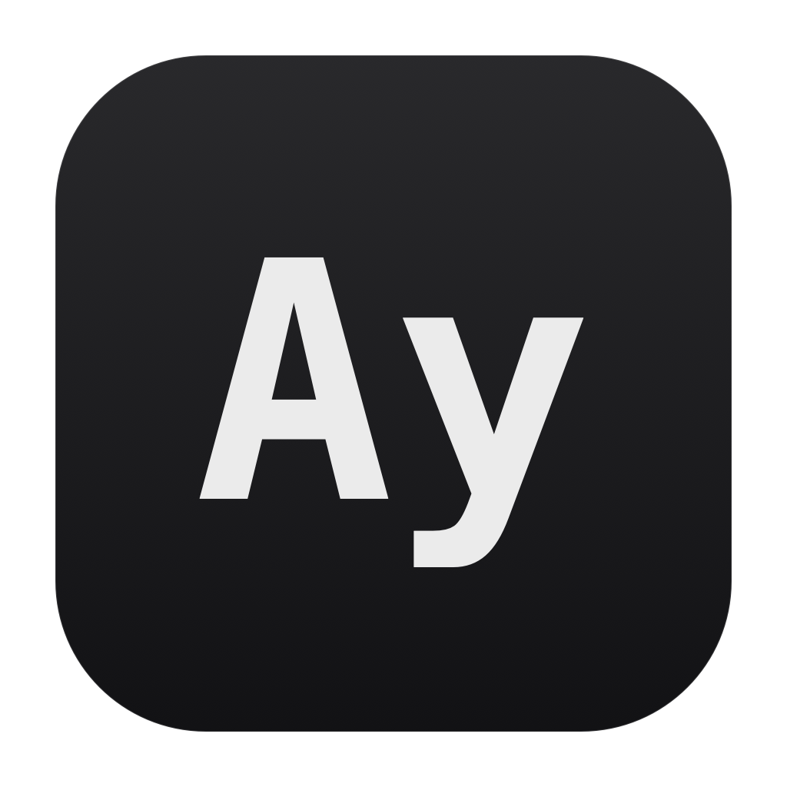
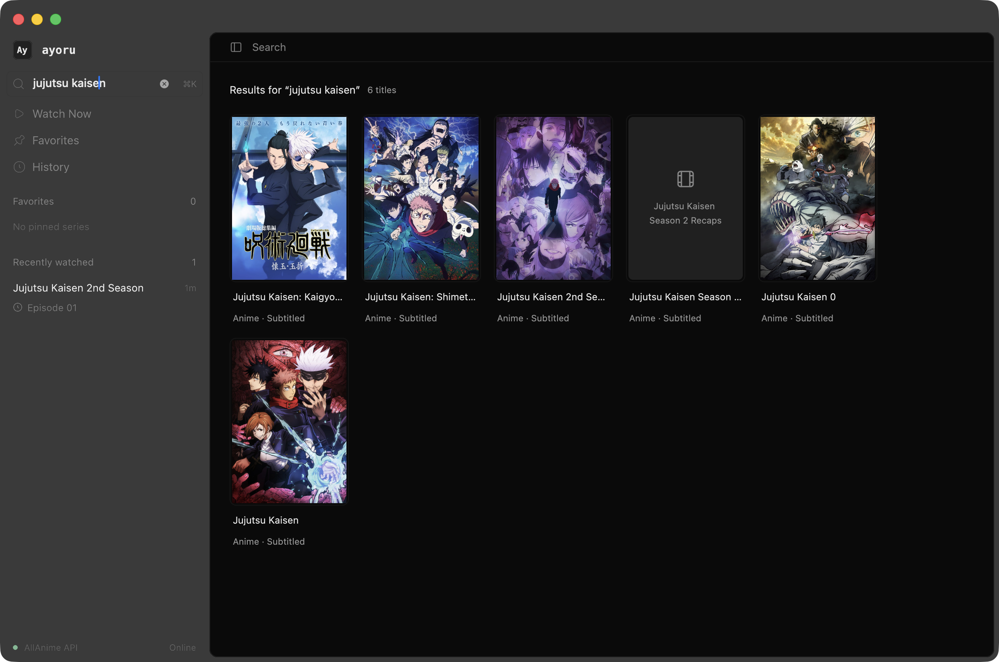
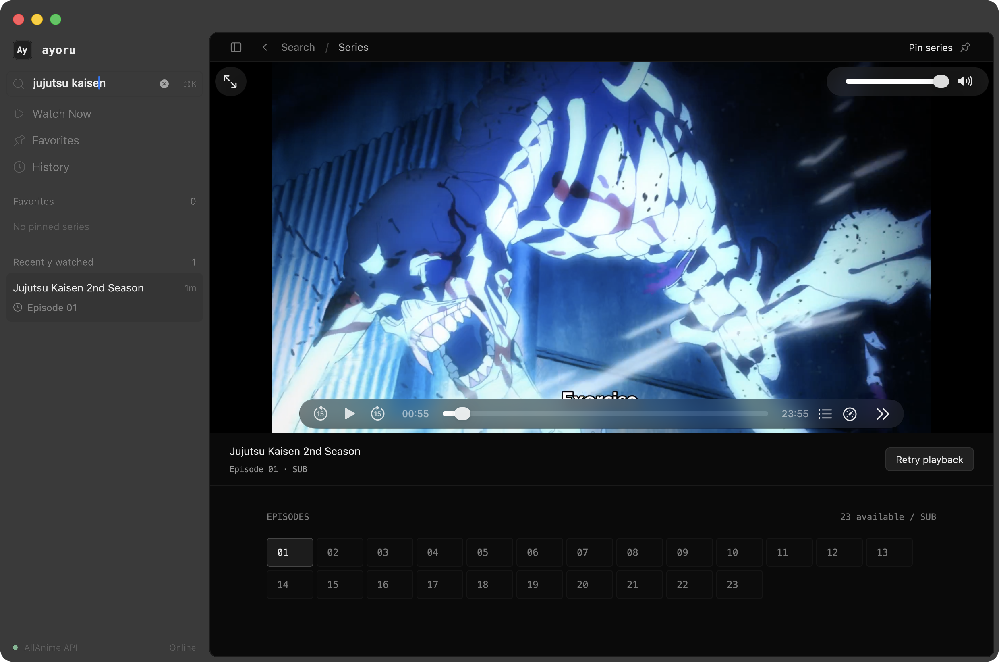
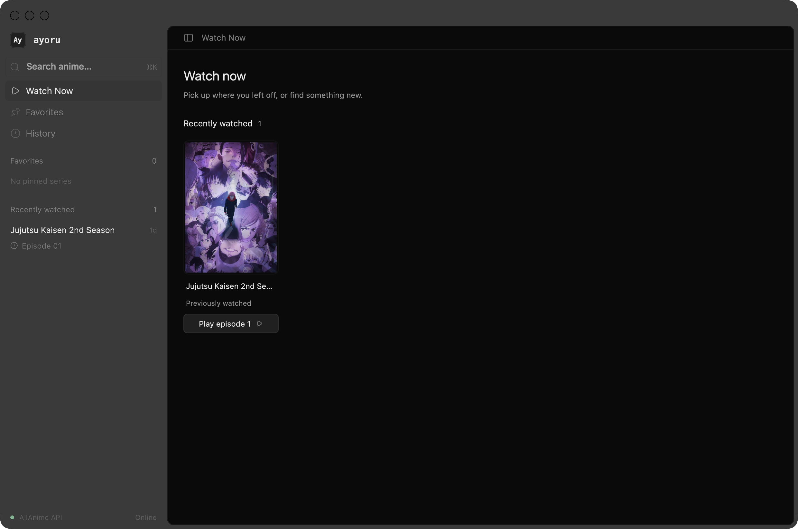

<p align="center">
  
</p>

# ayoru

[](https://github.com/BrandonLee28/ayoru/actions/workflows/release.yml)
[](https://github.com/BrandonLee28/ayoru/releases/tag/alpha)

A quieter way to watch anime. A native macOS app built with Rust and [GPUI](https://gpui.rs/).

Search a title, choose an episode, and watch in the same window. Keep favorites and recently watched episodes in a local library, without an account.

> [!NOTE]
> ayoru is in active development. Playback depends on third-party providers, and some streams may be unavailable.

<p align="center">
  
</p>

<details>
<summary>More screenshots — playback and library</summary>

<p align="center">
  
</p>
<p align="center">
  
</p>

</details>

## Use ayoru

### Download the desktop app

**[Download ayoru for macOS →](https://github.com/BrandonLee28/ayoru/releases/tag/alpha)**

Choose the **Apple silicon** (`aarch64`) or **Intel** (`x86_64`) DMG, then drag **ayoru** to **Applications**. Requires macOS 12 or later. No external player is needed.

Builds are currently ad hoc signed. If macOS blocks the app, try opening it once, then choose **Open Anyway** in **System Settings → Privacy & Security**.

### Or install from your terminal

```sh
curl -fsSL https://raw.githubusercontent.com/BrandonLee28/ayoru/main/scripts/install.sh | sh
open ~/Applications/ayoru.app
```

### Prefer the terminal app?

The original keyboard-driven TUI is available on the **[cli branch](https://github.com/BrandonLee28/ayoru/tree/cli)**, with separate releases for macOS and Linux.

```sh
curl -fsSL https://raw.githubusercontent.com/BrandonLee28/ayoru/cli/scripts/install.sh | sh
ayoru
```

The terminal version needs `mpv`, `IINA`, or `VLC`. Both versions use the same local library format.

## Development

On macOS, install [Rust](https://rustup.rs/) and Apple's Command Line Tools (`xcode-select --install`), then run:

```sh
cargo run
```

The repository pins its Rust toolchain. To build an app and DMG:

```sh
cargo build --release --locked
sh scripts/package-macos.sh
```

## Further reading

- [User guide](docs/guide.md) — controls, local data, installation, and troubleshooting
- [Architecture](docs/highlevel.md) — source layout and how playback works
- [Development](CONTRIBUTING.md) — checks and release conventions
- [Report an issue](https://github.com/BrandonLee28/ayoru/issues)

## Acknowledgements

Built with [GPUI](https://gpui.rs/) and Apple's AVKit. Visual styling is adapted from Monocode Native; see [design attribution](THIRD_PARTY_NOTICES.md).
